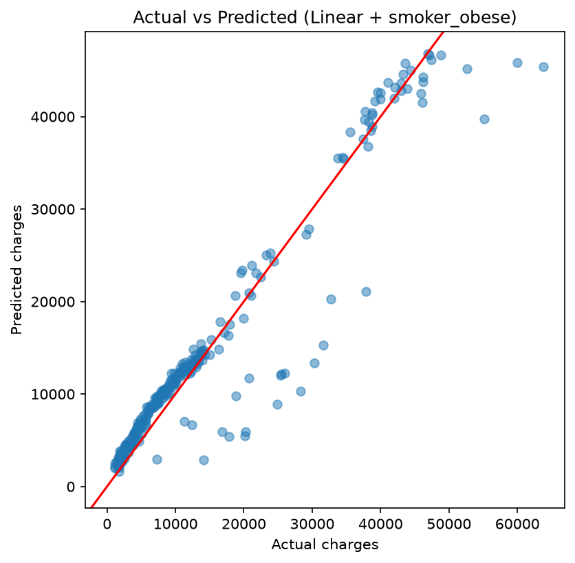
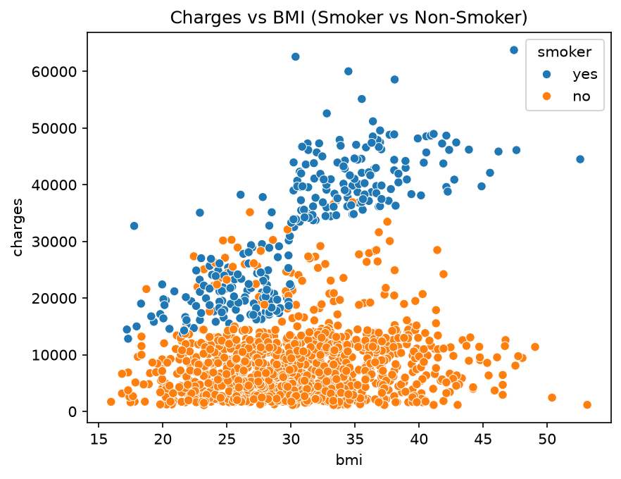

# Medical Cost Prediction

Predicts individual medical insurance charges from 6 personal attributes and serves the model through a FastAPI that can **explain each prediction**, feature by feature.

**Highlights**
- One engineered feature (`smoker_obese`) made a plain **Linear Regression beat a Random Forest** (R² 0.906 vs 0.883), confirmed with 5-fold cross-validation.
- Every prediction can be broken down into per-feature contributions (`POST /predict/explain`).
- Reproducible training (`python -m ml.train`), versioned model metadata and 11 automated tests.

## Results

Test set (20% of the data, `random_state=42`):

| Model | MAE | RMSE | R² |
|---|---|---|---|
| Baseline (`DummyRegressor`, always predicts the mean) | 9,862 | 13,612 | −0.008 |
| Linear Regression | 4,177 | 5,956 | 0.807 |
| Random Forest | 2,558 | 4,642 | 0.883 |
| **Linear Regression + `smoker_obese`** ✅ | **2,392** | **4,163** | **0.906** |

5-fold cross-validation on the training set (MAE): **Linear + `smoker_obese` 2,542 ± 188** vs. Random Forest 2,770 ± 204. The linear model wins in 4 of 5 folds, so the advantage is not a lucky split.



Most points lie close to the red line (perfect prediction), slightly above it for cheaper plans (a small, consistent overestimate). The scattered points below it are the few large underestimates (people who paid much more than their 6 features suggest), described in [Limitations](#limitations).

## Key finding: the smoker × BMI interaction



The EDA revealed three groups: non-smokers, smokers with BMI < 30 and smokers with BMI ≥ 30. For smokers, crossing BMI 30 makes charges **jump** from ~20k to ~40k: a step, not a slope.

A plain linear model has a single weight for `smoker`, so it averaged the two smoker groups (overestimating non-obese smokers by ~7k and underestimating obese smokers by ~9k). The Random Forest found the interaction on its own, but a single 0/1 column, `smoker_obese = smoker AND bmi >= 30`, let the linear model represent it directly:

- `smoker_yes`: **+13.3k** (non-obese smoker vs. non-smoker)
- `smoker_obese`: **+19.5k** on top of that (obese smoker: **+32.7k** in total)

These values match the group medians seen in the EDA. The linear model was chosen for production: more accurate, simpler and explainable.

Full analysis: [`notebooks/01-kf-eda.ipynb`](notebooks/01-kf-eda.ipynb) and [`notebooks/02-kf-models.ipynb`](notebooks/02-kf-models.ipynb).

## Dataset

[Medical Cost Personal Datasets](https://www.kaggle.com/datasets/mirichoi0218/insurance) (Kaggle): 1,338 rows × 7 columns, no missing values, 1 duplicated row removed.

- Features: `age`, `sex`, `bmi`, `children`, `smoker`, `region`
- Target: `charges` (individual medical costs billed by health insurance)
- License: LICENSE_NAME (see the dataset page)

## Project structure

```
├── app/            # FastAPI: main.py, routes.py, schemas.py, model.py
├── ml/             # config, data loading, features, training and evaluation
├── notebooks/      # 01 EDA · 02 model comparison
├── data/raw/       # insurance.csv
├── models/         # model.joblib + metadata.json (generated, not versioned)
├── reports/        # metrics.json + EDA figures
└── tests/          # ml/ and api/
```

## Getting started

Requires Python 3.14.

```bash
git clone https://github.com/KaduFallone/medical-cost-prediction.git
cd medical-cost-prediction

python -m venv .venv
.venv\Scripts\Activate.ps1        # Windows (PowerShell)
source .venv/bin/activate         # Linux / macOS

pip install -r requirements-dev.txt
```

Requirements are chained: `requirements.txt` (API + model) ← `requirements-ml.txt` (+ notebooks) ← `requirements-dev.txt` (+ tests and tools). For the API only, install `requirements.txt`.

### 1. Train the model

```bash
python -m ml.train
```

This creates:
- `models/model.joblib`: the trained pipeline (not versioned, so run this after cloning)
- `models/metadata.json`: scikit-learn version, feature order, training date, metrics and SHA-256 hash of the dataset
- `reports/metrics.json`: test metrics

### 2. Run the API

```bash
uvicorn app.main:app --reload
```

Interactive docs: http://127.0.0.1:8000/docs

## API

| Method | Endpoint | Description |
|---|---|---|
| `GET` | `/health` | API is up and the model is loaded |
| `GET` | `/model` | Metadata of the model being served |
| `POST` | `/predict` | Predicted charges for one patient |
| `POST` | `/predict/explain` | Prediction broken down by feature |

Example request body:

```json
{"age": 40, "sex": "male", "bmi": 32, "children": 1, "smoker": "yes", "region": "southeast"}
```

`POST /predict`:

```json
{"charges": 41071.59}
```

`POST /predict/explain`:

```json
{
  "baseline": 9130.85,
  "contributions": {
    "num__age": 207.78,
    "num__bmi": 71.51,
    "num__children": -47.07,
    "cat__sex_male": -476.39,
    "cat__smoker_yes": 13292.37,
    "cat__region_northwest": 0,
    "cat__region_southeast": -562.39,
    "cat__region_southwest": 0,
    "int__smoker_obese": 19454.94
  },
  "charges": 41071.59
}
```

**How to read it:** `baseline + sum(contributions) = charges`.
- `baseline` is the prediction for a **reference person**: average age, BMI and number of children (training set), female, non-smoker, from the northeast.
- Each contribution is how much this patient moves the price away from that reference. Numeric features are standardized, so their contribution is relative to the training average (age 40 is close to the average, hence only +208).
- This breakdown is exact only because the model is linear. A tree-based model would need a technique such as SHAP.

### Input validation

Values outside the training range are rejected with `422`:

| Field | Accepted values |
|---|---|
| `age` | 18 to 64 |
| `sex` | `female`, `male` |
| `bmi` | 15 ≤ bmi < 55 |
| `children` | 0 to 5 |
| `smoker` | `yes`, `no` |
| `region` | `northeast`, `northwest`, `southeast`, `southwest` |

The model never saw anyone older than 64, for example: a linear model would extrapolate a number that looks precise but is not backed by data.

At startup the API compares the scikit-learn version stored in `metadata.json` with the installed one and refuses to start if they differ, since a model saved with another version may fail to load or silently predict differently.

## Tests

```bash
python -m pytest -v
```

11 tests:
- `tests/ml/test_features.py`: `smoker_obese` for all 4 smoker × obese combinations, including the boundary BMI = 30; the input is not modified
- `tests/ml/test_train.py`: the pipeline trains on a 60-row sample, returns one prediction per row, and `evaluate` returns MAE, RMSE and R²
- `tests/ml/test_model.py`: the saved model loads and predicts; metadata matches the installed scikit-learn version and the feature order
- `tests/api/test_api.py`: `/health`, `/model`, `/predict` returns the same value as the service, `age = 90` returns 422, and the explanation adds up to the prediction

Tests that need the saved model are skipped until `python -m ml.train` is run. pytest currently shows a `StarletteDeprecationWarning` (TestClient + `httpx`): it is harmless and will be handled in the next dependency update.

## Design decisions

- **Same split for every model** (`random_state=42`, `test_size=0.2`); preprocessing lives inside a `Pipeline` fitted on the training data only (no leakage).
- **Custom transformer as a class** in `ml/features.py` (no `lambda`), so `joblib` can reload the saved pipeline.
- **Flat `app/`** (`main.py`, `routes.py`, `schemas.py`, `model.py`): one resource (predictions) with four endpoints. It would be split into `routers/` and `services/` if a second resource were added.
- **Pinned versions** (`==`); the model is loaded once (`lru_cache`) and at startup, so problems fail fast.

## Limitations

- Small dataset (1,337 rows after removing the duplicate). A few errors of 15k–20k remain: isolated cases that the 6 features cannot explain.
- Predictions are restricted to the training ranges (age 18–64, BMI 15–55, 0–5 children).
- `/predict/explain` depends on the model being linear.

## Tech stack

Python 3.14 · scikit-learn 1.9.1 · pandas 3.1.1 · NumPy 2.5.5 · FastAPI 0.163.2 · Uvicorn 0.54.0 · Pydantic · joblib 1.6.0 · pytest 9.2.0 · Ruff 0.17.5

## Author

Kadu · [github.com/KaduFallone](https://github.com/KaduFallone)